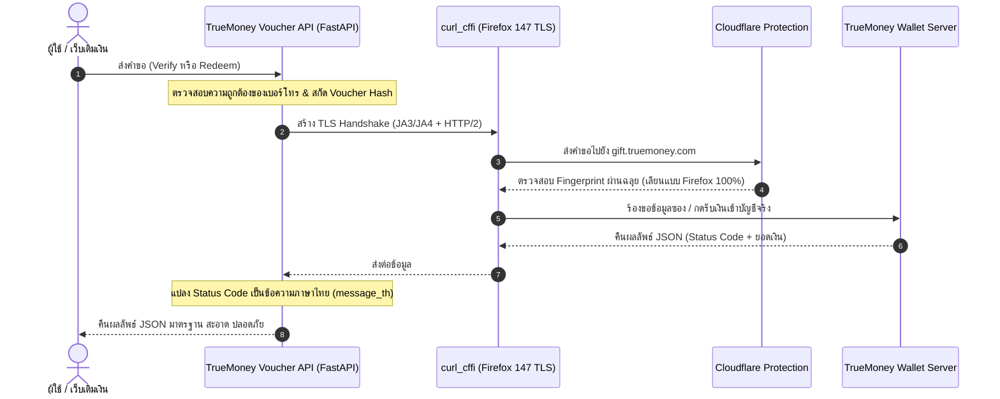

# 🧧 TrueMoney Voucher API (Python / FastAPI)

<p align="center">
  
  
  
  
  
  
</p>

<p align="center"> <b>API ประสิทธิภาพสูงสำหรับตรวจสอบ (Verify) และกดรับเงิน (Redeem) ซองของขวัญ / อั่งเปา TrueMoney Wallet เข้ากระเป๋าจริงอัตโนมัติ</b><br> พัฒนาด้วย Python (FastAPI) ผสานเทคโนโลยี <b>TLS Impersonation (Firefox 147 JA3/JA4 Handshake)</b> ผ่าน <code>curl_cffi</code><br>
  บายพาสระบบตรวจจับ Cloudflare Bot Protection 100% ไม่ต้องติดตั้ง Binary เสริม รองรับ Vercel Serverless ฟรี 24/7
</p>

---

## 📋 สารบัญ

- [สถาปัตยกรรมการทำงาน (Architecture Flow)](#-สถาปัตยกรรมการทำงาน-architecture-flow)
- [จุดเด่นและคุณสมบัติหลัก](#-จุดเด่นและคุณสมบัติหลัก)
- [Base URL & Interactive Documentation](#-base-url--interactive-documentation)
- [รูปแบบลิงก์ซองที่รองรับ](#-รูปแบบลิงก์ซองที่รองรับ)
- [API Reference (เอกสารอ้างอิงทุก Endpoint)](#-api-reference-เอกสารอ้างอิงทุก-endpoint)
  - [1. POST /verify — ตรวจสอบข้อมูลซอง (ไม่ตัดเงิน)](#1-post-verify--ตรวจสอบข้อมูลซอง-ไม่ตัดเงิน)
  - [2. POST /redeem — กดรับเงินเข้ากระเป๋าวอลเล็ตจริง](#2-post-redeem--กดรับเงินเข้ากระเป๋าวอลเล็ตจริง)
  - [3. GET /verify/{voucher_hash}/{mobile} — ทางลัดตรวจสอบผ่าน GET](#3-get-verifyvoucher_hashmobile--ทางลัดตรวจสอบผ่าน-get)
  - [4. GET /truemoney/{voucher_hash}/{mobile} — ทางลัดรับเงินผ่าน GET](#4-get-truemoneyvoucher_hashmobile--ทางลัดรับเงินผ่าน-get)
  - [5. GET /health — ตรวจสอบสถานะ Engine & TLS Profile](#5-get-health--ตรวจสอบสถานะ-engine--tls-profile)
  - [6. GET / — ข้อมูลภาพรวมและรายการ Routes](#6-get---ข้อมูลภาพรวมและรายการ-routes)
- [ตารางรหัสสถานะ TrueMoney (Status Codes)](#-ตารางรหัสสถานะ-truemoney-status-codes)
- [คู่มือการนำไปทำระบบเติมเงินอัตโนมัติ (Automated Payment Flow)](#-คู่มือการนำไปทำระบบเติมเงินอัตโนมัติ-automated-payment-flow)
- [การติดตั้งและรัน Local](#-การติดตั้งและรัน-local)
- [ขั้นตอนการ Deploy ขึ้น Vercel (iad1)](#-ขั้นตอนการ-deploy-ขึ้น-vercel-iad1)
- [ข้อจำกัดความรับผิดชอบและสัญญาอนุญาต (Disclaimer & License)](#-ข้อจำกัดความรับผิดชอบและสัญญาอนุญาต)

---

## 🏗️ สถาปัตยกรรมการทำงาน (Architecture Flow)



---

## ✨ จุดเด่นและคุณสมบัติหลัก

* 🛡️ **Bypass Cloudflare สมบูรณ์แบบ:** จำลอง TLS Fingerprint (JA3/JA4) และ HTTP/2 Header สเปกเดียวกับ Mozilla Firefox 147 ข้ามหน้าตรวจจับบอต Cloudflare ได้ 100%
* ⚡ **Vercel Serverless Ready:** ตั้งค่าภูมิภาค Washington D.C. (`iad1`) ล่วงหน้าใน `vercel.json` ปลอดภัยจากการบล็อก IP ทำงานได้ 24/7 ไม่ต้องมีเซิร์ฟเวอร์ส่วนตัว

* 🔄 **Dual Method Support:** รองรับทั้ง `POST` (JSON Body ปลอดภัยสูง) และ `GET` (URL Path สะดวก รวดเร็ว)
* 🧠 **Smart Parameter Resolver:** สลับตำแหน่งให้อัตโนมัติ หากส่งเบอร์โทรมาก่อนรหัสซอง หรือส่งรหัสซองมาก่อนเบอร์โทร
* 🇹🇭 **Native Thai Messages:** มีระบบแปลรหัสสถานะของ TrueMoney เช่น `VOUCHER_EXPIRED`, `VOUCHER_OUT_OF_STOCK` เป็นภาษาไทย (`message_th`) ในตัว
* 🚫 **Clean Validation Errors:** เมื่อลืมใส่พารามิเตอร์ ระบบแจ้งเตือนเฉพาะชื่อฟิลด์ที่ขาดอย่างกระชับ เช่น `{"detail": "ขาดฟิลด์ mobile"}`
* 🌐 **Full CORS Support:** เปิดสิทธิ์ CORS (`*`) ใช้งานร่วมกับ Single Page Application (React, Vue, Next.js, HTML) ได้ทันที
* 📖 **Interactive Docs:** เอกสาร Swagger UI (`/docs`) และ ReDoc (`/redoc`) ในตัว

---

## 🌐 Base URL & Interactive Documentation

| สภาพแวดล้อม | Base URL | เอกสาร API |
| :--- | :--- | :--- |
| **Local Development** | `http://localhost:8000` | [http://localhost:8000/docs](http://localhost:8000/docs) |
| **Production (Vercel)** | `https://<your-project>.vercel.app` | `https://<your-project>.vercel.app/docs` |

---

## 🔗 รูปแบบลิงก์ซองที่รองรับ

ระบบมี Smart Parser ตัดสตริงสกัดเฉพาะรหัส Hash อัตโนมัติ ส่งเข้ามาได้ทุกลักษณะ:
1. **ลิงก์หน้าซองแบบใหม่:** `https://gift.truemoney.com/campaign/voucher_detail?v=01a0c04029fe748aa3703ab162f3d24bfdq`
2. **ลิงก์หน้าซองแบบเดิม:** `https://gift.truemoney.com/campaign/?v=01a0c04029fe748aa3703ab162f3d24bfdq`
3. **เฉพาะรหัสโค้ด (Hash):** `01a0c04029fe748aa3703ab162f3d24bfdq`

*(รองรับเบอร์โทรศัพท์แบบมีขีด เช่น `081-234-5678`, เคาะวรรค, หรือรหัสประเทศ `+66` โดยระบบจะแปลงเป็น 10 หลักขึ้นต้นด้วย 0 ให้อัตโนมัติ)*

---

## 📡 API Reference (เอกสารอ้างอิงทุก Endpoint)

---

### 1. `POST /verify` — ตรวจสอบข้อมูลซอง (ไม่ตัดเงิน)

ใช้สำหรับตรวจสอบว่าซองใช้งานได้หรือไม่ ยอดเงินคงเหลือเท่าใด และใครเป็นผู้สร้างซอง **โดยยังไม่ตัดเงินหรือทำธุรกรรม**

* **Method:** `POST`
* **Path:** `/verify`
* **Headers:** `Content-Type: application/json`

#### Request Body Parameters:
| ฟิลด์ | ชนิด | จำเป็น | คำอธิบาย | ตัวอย่าง |
| :--- | :---: | :---: | :--- | :--- |
| `mobile` | `string` | **ใช่** | เบอร์ TrueMoney Wallet ผู้ตรวจสอบ (10 หลัก) | `"01234567890"` |
| `voucher_url` | `string` | **ใช่** | ลิงก์ซองของขวัญ หรือเฉพาะรหัส Hash | `"01a0c04029fe748aa3703ab162f3d24bfdq"` |

#### ตัวอย่างคำขอ (cURL):
```bash
curl -X POST http://localhost:8000/verify \
  -H "Content-Type: application/json" \
  -d '{
    "mobile": "01234567890",
    "voucher_url": "https://gift.truemoney.com/campaign/?v=01a0c04029fe748aa3703ab162f3d24bfdq"
  }'
```

#### ตัวอย่างผลลัพธ์ตอบกลับ (200 OK — ซองปกติพร้อมใช้งาน):
```json
{
  "proxy_error": false,
  "http_code": 200,
  "data": {
    "status": {
      "message": "success",
      "code": "SUCCESS",
      "message_th": "รับเงินสำเร็จ / ข้อมูลซองถูกต้อง"
    },
    "data": {
      "voucher": {
        "voucher_id": "541334319161963919",
        "amount_baht": "50.00",
        "redeemed_amount_baht": "0.00",
        "member": 1,
        "status": "active",
        "link": "01a0c04029fe748aa3703ab162f3d24bfdq",
        "detail": "",
        "expire_date": 1790018225731,
        "type": "F",
        "redeemed": 0,
        "available": 1
      },
      "owner_profile": {
        "full_name": "สมชาย ***",
        "tmn_id": "tmn.10144069424"
      }
    }
  }
}
```

---

### 2. `POST /redeem` — กดรับเงินเข้ากระเป๋าวอลเล็ตจริง

ใช้สำหรับส่งคำขอตัดเงินจากซองและโอนเงินเข้าบัญชี TrueMoney Wallet ของเบอร์ที่ระบุทันที

* **Method:** `POST`
* **Path:** `/redeem`
* **Headers:** `Content-Type: application/json`

#### Request Body Parameters:
| ฟิลด์ | ชนิด | จำเป็น | คำอธิบาย | ตัวอย่าง |
| :--- | :---: | :---: | :--- | :--- |
| `mobile` | `string` | **ใช่** | เบอร์ TrueMoney Wallet ที่ต้องการรับเงินเข้าบัญชี | `"01234567890"` |
| `voucher_url` | `string` | **ใช่** | ลิงก์ซองของขวัญ หรือเฉพาะรหัส Hash | `"01a0c04029fe748aa3703ab162f3d24bfdq"` |

#### ตัวอย่างคำขอ (cURL):
```bash
curl -X POST http://localhost:8000/redeem \
  -H "Content-Type: application/json" \
  -d '{
    "mobile": "01234567890",
    "voucher_url": "01a0c04029fe748aa3703ab162f3d24bfdq"
  }'
```

#### ตัวอย่างผลลัพธ์ตอบกลับ (200 OK — รับเงินสำเร็จ):
```json
{
  "proxy_error": false,
  "http_code": 200,
  "data": {
    "status": {
      "message": "success",
      "code": "SUCCESS",
      "message_th": "รับเงินสำเร็จ / ข้อมูลซองถูกต้อง"
    },
    "data": {
      "voucher": {
        "voucher_id": "541334319161963919",
        "amount_baht": "50.00",
        "redeemed_amount_baht": "50.00",
        "member": 1,
        "status": "redeemed"
      },
      "owner_profile": {
        "full_name": "สมชาย ***",
        "tmn_id": "tmn.10144069424"
      },
      "redeemer_profile": {
        "mobile_number": "01234567890"
      },
      "my_ticket": {
        "amount_baht": "50.00"
      }
    }
  }
}
```

---

### 3. `GET /verify/{voucher_hash}/{mobile}` — ทางลัดตรวจสอบผ่าน GET

Endpoint ลัดสำหรับตรวจสอบสถานะซองผ่าน URL Path เหมาะสำหรับการทดสอบผ่านเบราว์เซอร์หรือระบบเดิม

* **Method:** `GET` หรือ `POST`
* **Path:** `/verify/{voucher_hash}/{mobile}`
* **หมายเหตุ:** ระบบมี Smart Resolver สามารถสลับเอาเบอร์โทรขึ้นก่อน หรือเอารหัสซองขึ้นก่อนได้

#### ตัวอย่างการเรียกใช้งาน:
```bash
curl -X GET http://localhost:8000/verify/01a0c04029fe748aa3703ab162f3d24bfdq/01234567890
```

---

### 4. `GET /truemoney/{voucher_hash}/{mobile}` — ทางลัดรับเงินผ่าน GET

Endpoint ลัดสำหรับกดรับเงินเข้ากระเป๋าจริงผ่าน URL Path (รูปแบบเดียวกับ API บน Vercel ดั้งเดิม เช่น `truemoney-voucher-nestjs`)

* **Method:** `GET` หรือ `POST`
* **Path:** `/truemoney/{voucher_hash}/{mobile}`

#### ตัวอย่างการเรียกใช้งาน:
```bash
curl -X GET http://localhost:8000/truemoney/01a0c04029fe748aa3703ab162f3d24bfdq/01234567890
```

---

### 5. `GET /health` — ตรวจสอบสถานะ Engine & TLS Profile

ใช้ตรวจสอบสถานะการทำงานของเซิร์ฟเวอร์ ดูโปรไฟล์ TLS Impersonation และเวอร์ชันของระบบ

* **Method:** `GET`
* **Path:** `/health`

#### ผลลัพธ์ตัวอย่าง:
```json
{
  "status": "ok",
  "powered_by": "equalsignorecase",
  "engine": "curl_cffi",
  "impersonate": "firefox147",
  "python_version": "3.14.7"
}
```

---

### 6. `GET /` — ข้อมูลภาพรวมและรายการ Routes

* **Method:** `GET`
* **Path:** `/`

#### ผลลัพธ์ตัวอย่าง:
```json
{
  "message": "TrueMoney Voucher API (Python / FastAPI)",
  "powered_by": "equalsignorecase",
  "docs": "/docs",
  "endpoints": {
    "health": "GET /health",
    "verify": "POST /verify or GET /verify/{voucher_hash}/{mobile}",
    "redeem": "POST /redeem or GET /truemoney/{voucher_hash}/{mobile}"
  }
}
```

---

## 📊 ตารางรหัสสถานะ TrueMoney (Status Codes)

ค่าที่ส่งกลับมาจาก TrueMoney ใน `data.status.code` และความหมายที่ระบบแปลให้:

| รหัสสถานะ (Code) | ข้อความภาษาไทย (`message_th`) | คำอธิบายและแนวทางปฏิบัติ |
| :--- | :--- | :--- |
| `SUCCESS` | รับเงินสำเร็จ / ข้อมูลซองถูกต้อง | เติมเงินสำเร็จ ให้ส่งมอบสินค้า/บริการได้ทันที |
| `VOUCHER_OUT_OF_STOCK` | ซองของขวัญถูกรับเงินไปหมดแล้ว | ซองนี้มีคนกดรับยอดเงินไปจนหมดแล้ว |
| `VOUCHER_EXPIRED` | ซองของขวัญหมดอายุแล้ว (เกิน 72 ชั่วโมง) | ซองสร้างเกิน 3 วัน ไม่สามารถรับเงินได้ |
| `VOUCHER_NOT_FOUND` | ไม่พบข้อมูลซองของขวัญในระบบ หรือลิงก์ไม่ถูกต้อง | รหัส Hash ผิด ลิงก์เสีย หรือซองถูกลบ |
| `CANNOT_GET_OWN_VOUCHER` | ไม่สามารถกดรับซองของตนเองได้ | เบอร์ผู้รับเงินเป็นเบอร์เดียวกับผู้สร้างซอง |
| `TARGET_USER_REDEEMED` | เบอร์โทรศัพท์นี้เคยรับเงินจากซองนี้ไปแล้ว | เบอร์ผู้รับนี้เคยกดรับซองนี้ไปแล้วในอดีต |
| `TARGET_USER_NOT_FOUND` | ไม่พบบัญชี TrueMoney Wallet ของเบอร์โทรศัพท์นี้ | ตรวจสอบว่าเบอร์ผู้รับเปิดใช้วอลเล็ตแล้วหรือไม่ |
| `INTERNAL_ERROR` | เกิดข้อผิดพลาดจากระบบ TrueMoney กรุณาลองใหม่อีกครั้ง | ระบบทรูมีปัญหาชั่วคราว ให้ลองใหม่อีกครั้ง |

---

## 🔄 คู่มือการนำไปทำระบบเติมเงินอัตโนมัติ (Automated Payment Flow)

สถาปัตยกรรมแนะนำสำหรับการเชื่อมต่อกับระบบร้านค้าออนไลน์ หรือ Webhook:

```
[ ลูกค้ากรอกเบอร์ร้าน + ลิงก์ซอง ]
                ⬇️
1. [Backend ร้านค้า] เรียก API: POST /verify
   - ตรวจสอบยอดเงิน (voucher.amount_baht) ว่าตรงกับราคาสินค้าหรือไม่
   - ตรวจสอบสถานะว่า status.code == "SUCCESS"
                ⬇️
2. [Backend ร้านค้า] เรียก API: POST /redeem
   - ส่งคำขอกดรับเงินเข้าเบอร์วอลเล็ตของร้านค้าจริง
   - ตรวจสอบว่า my_ticket.amount_baht ได้รับเงินครบถ้วน
                ⬇️
3. [Backend ร้านค้า] ปรับสถานะคำสั่งซื้อ & ปล่อยสินค้า
   - บันทึก voucher_id และ tmn_id ลงฐานข้อมูลเพื่อป้องกันการยิงซองซ้ำ
   - ปลดล็อกสินค้าหรือเพิ่มพอยต์ให้ลูกค้าทันที
```

---

## 🛠️ การติดตั้งและรัน Local

```bash
# 1. ติดตั้ง Dependencies
pip3 install -r requirements.txt

# 2. เริ่มต้นรันเซิร์ฟเวอร์สำหรับทดสอบ
python3 main.py
```
* เข้าทดสอบผ่านหน้า **Interactive Swagger:** `http://localhost:8000/docs`

---

## 🚀 ขั้นตอนการ Deploy ขึ้น Vercel (iad1)

โปรเจกต์นี้ตั้งค่า [`vercel.json`](file:///Users/user/Desktop/truewallet-api/vercel.json) กำหนดโซนไปที่ **US East (`iad1`)** และใช้ `builds` + `routes` ให้เรียบร้อยแล้ว:

1. **บันทึกโค้ดและส่งขึ้น GitHub:**
   ```bash
   git add .
   git commit -m "feat: ready for production deployment"
   git push origin main
   ```
2. **สร้างโปรเจกต์บน Vercel:**
   - เข้า [vercel.com](https://vercel.com) ล็อกอินด้วยบัญชี GitHub
   - คลิก **Add New...** ➔ **Project** ➔ เลือก Repository นี้
   - กดปุ่ม **Deploy** (Vercel จะตรวจจับ `requirements.txt` และ `api/index.py` อัตโนมัติ)
3. **เสร็จสิ้น:**
   - จะได้รับโดเมนพร้อมใช้งาน เช่น `https://truewallet-api.vercel.app` ใช้งานได้ตลอด 24 ชั่วโมงฟรี

---

## 📜 ข้อจำกัดความรับผิดชอบและสัญญาอนุญาต

### ข้อจำกัดความรับผิดชอบ (Disclaimer)
> โครงการนี้พัฒนาขึ้นเพื่อการศึกษาและการวิจัยทางเทคนิคเกี่ยวกับระบบเครือข่ายและ TLS Impersonation เท่านั้น ผู้พัฒนาไม่มีความเกี่ยวข้องใดๆ กับบริษัท ทรู ดิจิทัล กรุ๊ป หรือ TrueMoney Wallet ผู้ใช้งานต้องรับผิดชอบต่อการใช้งานบัญชีและธุรกรรมของตนเองตามกฎหมายและข้อกำหนดการใช้งานของผู้ให้บริการ

### สัญญาอนุญาต (License)
โครงการนี้เผยแพร่ภายใต้สัญญาอนุญาต **[MIT License](file:///Users/user/Desktop/truewallet-api/LICENSE)**

<p align="center">
  <b>Powered by equalsignorecase</b>
</p>
